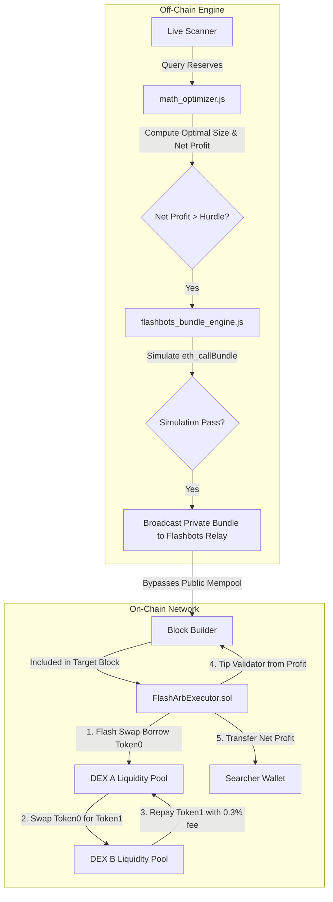

# DEX-to-DEX Arbitrage System with Flashbots Private Bundles

A production-grade, uncollateralized smart contract and off-chain searcher engine designed for atomic arbitrage between Uniswap V2 compatible decentralized exchanges (Uniswap, SushiSwap, PancakeSwap, etc.) with **Private Bundle MEV protection**.

---

## Architecture Overview



---

## Key Security & Architectural Features

### 1. Flashbots Private Bundles (Mempool Invisibility)
* **Zero Public Leakage:** Transactions are never broadcasted to the public Ethereum/EVM mempool. Competitor MEV bots cannot see, copy, or front-run your trade.
* **Zero-Cost Revert Protection:** If market conditions shift before the block is built, the Flashbots builder drops the bundle. **You pay $0.00 in gas fees for missed opportunities.**
* **Direct Miner Tipping:** The smart contract sends a conditional tip directly to `block.coinbase` only when profit is realized.

### 2. Zero-Capital Flash Swaps
* The contract borrows tokens directly from Pool A using Uniswap V2's `swap(..., data)` callback.
* No upfront capital is needed to fund the swap volume.

### 3. Convex Mathematical Trade Size Optimizer
* Swapping too small leaves profit on the table.
* Swapping too large creates price impact (slippage) that destroys profitability.
* `scripts/math_optimizer.js` calculates the mathematical sweet spot ($\Delta a^*$) in $<1\text{ ms}$ using a high-precision ternary search over the concave profit curve.

---

## File Structure

```text
├── contracts/
│   ├── FlashArbExecutor.sol         # Main arbitrage executor with Flashbots tipping
│   ├── interfaces/
│   │   ├── IUniswapV2Pair.sol       # Uniswap V2 pair interface
│   │   ├── IUniswapV2Callee.sol     # Flash swap callback interface
│   │   ├── IUniswapV2Router02.sol   # Uniswap V2 router interface
│   │   └── IWETH.sol                # WETH deposit/withdraw interface
│   ├── libraries/
│   │   └── UniswapV2Library.sol     # getAmountIn / getAmountOut math
│   └── mocks/
│       ├── MockERC20.sol            # Test ERC20 token
│       ├── MockWETH.sol             # Test WETH contract
│       └── MockUniswapV2Pair.sol    # Test pair with k invariant and flash swap
├── scripts/
│   ├── run_test_suite.js            # End-to-end simulation runner
│   ├── test_math.js                 # Verification test for trade size optimizer
│   ├── math_optimizer.js            # Convex AMM trade optimizer
│   ├── flashbots_bundle_engine.js   # Private bundle builder & relayer
│   └── live_scanner.js              # Real-time mempool-less arbitrage scanner
├── hardhat.config.js                # Hardhat 3 configuration with viaIR optimizer
├── .env.example                     # Environment variables template
└── package.json
```

---

## How to Test and Run

### 1. Run the End-to-End Simulation
To verify the complete smart contract flash swap lifecycle, pool reserve updates, profit capture, and revert protections:
```powershell
node scripts/run_test_suite.js
```

### 2. Verify the Mathematical Optimizer
To see how the optimizer determines the exact optimal trade size and compares it against suboptimal amounts:
```powershell
node scripts/test_math.js
```

### 3. Running Live Monitoring (Sepolia or Mainnet)
1. Copy `.env.example` to `.env`:
   ```powershell
   Copy-Item .env.example .env
   ```
2. Fill in your RPC URL, Private Key, and the pair contract addresses you wish to monitor.
3. Start the scanner:
   ```powershell
   node scripts/live_scanner.js
   ```
