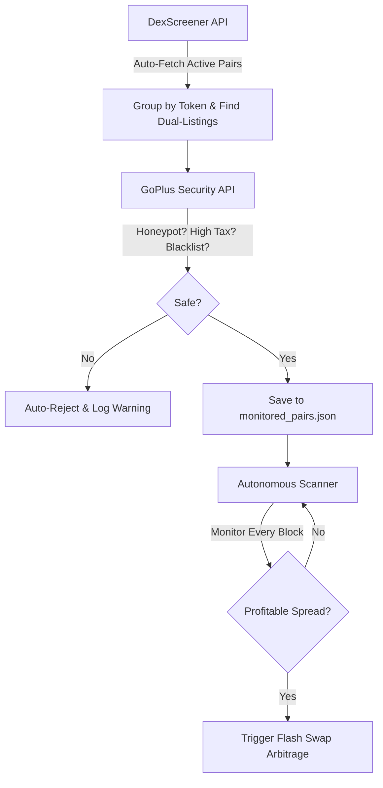

# Fully Autonomous Arbitrage Engine: Automated Discovery & Scam Filtering

This document explains how the newly built **Autonomous Discovery Pipeline** completely eliminates the need for manual searching on DexScreener or manual contract copying.

---

## 1. What Was Automated?

Previously, you had to manually:
1. Browse DexScreener.
2. Find tokens with listings on two DEXes.
3. Manually copy the pair contract addresses.
4. Manually check TokenSniffer for honeypots.
5. Paste everything into `.env`.

**Now, that entire process is 100% automated by code.**



---

## 2. The 3 New Autonomous Modules

### Module 1: Automated Anti-Honeypot Scanner (`scripts/token_safety_checker.js`)
Connects to the **GoPlus Security API** to audit token smart contracts in milliseconds. It automatically verifies:
* **Honeypot Detection:** Confirms buyers can freely sell.
* **Taxes:** Rejects any token with buy or sell taxes greater than 1%.
* **Blacklists & Restrictions:** Verifies transfers cannot be paused or blacklisted by malicious creators.
* **Contract Verification:** Ensures the source code is public and open-source.

### Module 2: Automated Multi-DEX Pair Finder (`scripts/auto_pair_finder.js`)
* Scans all active pairs on the target network (e.g., Base or Arbitrum).
* Discovers tokens listed across multiple exchanges (e.g., Aerodrome vs. Uniswap vs. SushiSwap).
* Filters out mega-cap pools and illiquid pools ($2,000 to $5,000,000 liquidity range).
* Runs the anti-honeypot audit on each candidate and generates `monitored_pairs.json`.

### Module 3: Autonomous Multi-Pair Scanner (`scripts/auto_scanner.js`)
* Loads all verified safe pairs and monitors their on-chain reserves on **every new block**.
* Uses `math_optimizer.js` to calculate the exact optimal borrow amount and net profit.
* Refreshes the discovered pair list every 15 minutes in the background, adding new safe tokens and discarding dead pools automatically.

---

## 3. How to Run Autonomous Discovery

### Step 1: Run One-Click Pair Discovery
To scan the chain, audit tokens for safety, and save candidates:
```powershell
node scripts/auto_pair_finder.js base
```
*(Or replace `base` with `arbitrum`)*

**Sample Live Test Output:**
```text
[1/4] Fetching active market pairs from DexScreener...
  Discovered 51 eligible pools with liquidity > $2,000

[2/4] Grouping pools by token to find multi-DEX listings...
  Found 6 tokens active across multiple DEXes!

[3/4] Auditing candidates for honeypots, taxes, and blacklists...
  Checking Basecat... ✅ SAFE (Buy Tax: 0.0%, Sell Tax: 0.0%)
  Checking cbXRP...   ✅ SAFE (Buy Tax: 0.0%, Sell Tax: 0.0%)
  Checking PEPE...    ❌ REJECTED: TRANSFER_RESTRICTION (Malicious Honeypot Blocked)
  Checking TYBG...    ✅ SAFE (Buy Tax: 0.0%, Sell Tax: 0.0%)
  Checking cbZEC...   ✅ SAFE (Buy Tax: 0.0%, Sell Tax: 0.0%)
  Checking cbHYPE...  ✅ SAFE (Buy Tax: 0.0%, Sell Tax: 0.0%)

[4/4] Completed! Verified 5 safe arbitrage targets.
```

---

### Step 2: Start the Autonomous Engine
To start monitoring all verified pairs simultaneously on every block:
```powershell
node scripts/auto_scanner.js
```

The engine will track all pairs across each new block, automatically spot spreads, and execute flash swaps with zero human involvement.
